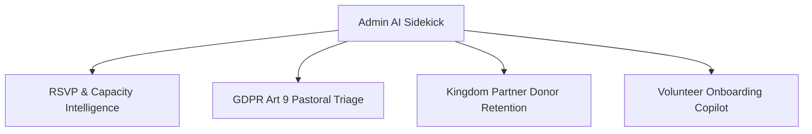

# Admin AI Sidekick Skill (`admin-sidekick`)

> **Domain**: GOSPELS Administration & Ministry Operations  
> **Classification**: Category A Non-Profit Ministry Platform  
> **LLM Backbone**: Google Gemini 2.5 Flash via `GEMINI_API_KEY`  
> **Compliance Surface**: Swedish GDPR Article 9, IMY Governance, Youth Safeguarding  

---

## 1. Core Purpose & Capabilities

The **Admin AI Sidekick** provides operational intelligence, decision support, and administrative automation for the GOSPELS leadership team in Gothenburg, Sweden. It bridges incoming community data with responsible ministry action across four specialized domains:

---

## 2. Operational Domains

### 2.1 Event RSVP & Capacity Forecasting
- **Attendance Projection**: Free non-profit concerts typically experience a 25–40% no-show rate. The Sidekick models historical RSVP confirmation signals (e.g., calendar downloads, confirmation link clicks) to forecast realistic physical turnouts.
- **Venue Saturation Alerts**: Triggers warnings when registrations reach 85%, 100%, and 115% of venue capacity (e.g., Gothenburg concert halls or outdoor designated zones).
- **Automated Communication Drafts**: Drafts contextual pre-event logistics updates (transit info, Gothenburg weather advisories, parking guidance) for one-click admin approval.

### 2.2 Pastoral Prayer Triage (Swedish GDPR Article 9)
- **Sensitive Data Classification**: Prayer requests contain special category personal data (religious beliefs, health conditions, personal grief). The Sidekick runs automated classification locally or via encrypted zero-retention API calls.
- **Urgency Scoring**:
  - `URGENT`: Hospitalization, acute grief, severe crisis $\rightarrow$ Immediately surfaces to designated pastoral leads with explicit emergency dispatch protocols.
  - `PASTORAL`: Life transitions, family salvation, spiritual growth $\rightarrow$ Routed to vetted prayer team intercessors.
  - `TESTIMONY`: Praise reports, answers to prayer $\rightarrow$ Tagged for potential anonymized sharing with explicit consent.
- **Strict Anti-Leakage Guardrails**: Prayer content is never syndicated, never indexed in public search, and automatically purges or anonymizes according to GOSPELS retention policies (12 months maximum).

### 2.3 Kingdom Partner Donor Retention (Swish & Stripe)
- **Commitment Health Tracking**: Monitors recurring 150 SEK/mo subscriptions and annual bankgiro pledges.
- **Payment Attrition Triage**: Identifies card expirations and failed Stripe charge attempts; automatically drafts warm, gracious Swedish/English re-engagement emails.
- **Transparency Summaries**: Aggregates impact metrics (e.g., "This quarter, 48 Kingdom Partners fully funded the sound engineering and venue rental for Holy Spirit Worship") for quarterly donor transparency reports.

### 2.4 Volunteer Intake & Safeguarding Screener
- **Role Matching**: Matches applicant skills (A/V production, acoustics, stage crew, hospitality, bilingual Swedish/English translation) to specific event needs.
- **Youth Safeguarding Guardrail**: Automatically detects applicants `< 18` and enforces the parent/guardian consent verification gate before scheduling interviews or shifts.

---

## 3. Integration Architecture

- **API Route**: `app/api/admin/sidekick/route.ts`
- **Engine**: Gemini Flash (`@google/genai` or direct REST endpoint with system instructions)
- **Authentication**: Strict Admin Role session gate via NextAuth / Supabase Auth (`role: 'admin'`)
- **Audit Logging**: Every AI triage recommendation and data access action is recorded in `AdminAuditLog` with timestamp and user ID.

---

## 4. Operational Commands for Agents & Admins

When invoked in conversation or via the admin console:
- `/sidekick forecast [event-id]`: Generates attendance projection and check-in logistics.
- `/sidekick prayer-summary`: Summarizes active prayer themes anonymously without exposing PII.
- `/sidekick donor-health`: Analyzes monthly recurring partner churn and upcoming renewal dates.
- `/sidekick volunteer-batch [event-id]`: Reviews pending volunteer submissions and identifies roster gaps.
